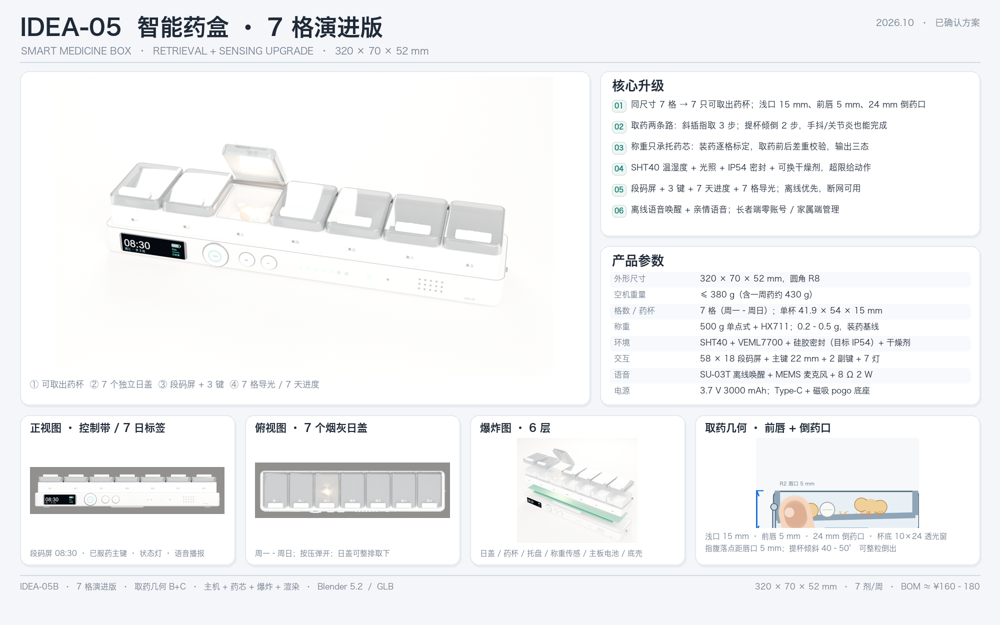

# IDEA-05 智能药盒 · 7 格演进版 · 交付包

> 版本：IDEA-05B（7 格，已确认方案）
> 日期：2026-10-18
> 内容：设计图板、设计文档、Blender 模型、GLB、渲染图、绘图脚本、参考图、调研笔记

---

## 0. 先看这 4 个

| 想了解 | 打开 |
|---|---|
| 整体设计长什么样 | `00_设计图板/09_IDEA-05B_design_board.png` |
| 设计定稿与参数 | `01_设计文档/08_IDEA-05B_7格定稿.md` |
| 取药几何为什么这样做 | `01_设计文档/07_取药几何优化.md` |
| 3D 模型 | `02_三维模型/IDEA-05_box.blend`（Blender 5.2） / `IDEA-05_box.glb` |
| 概念图板（可缩放） | `00_设计图板/10_IDEA-05B_concept_board.html`（双击离线打开）或 `.svg` |



---

## 1. 包内结构

```
IDEA-05_交付包/
├─ 00_设计图板/        概念图板（SVG/HTML/PNG）+ 顶视/正视/横剖/槽位对比/取药几何/方案对比
├─ 01_设计文档/        7 格定稿、取药几何、21 格概念对比、交付索引
├─ 02_三维模型/        .blend 源文件、开盖/闭盖 GLB、屏幕 UI 贴图
├─ 03_渲染图/          英雄图、正视图、俯视图、爆炸图、药杯细节；transparent/ 为透明背景源图
├─ 04_脚本/            Blender 建模/渲染/图板/2D 绘图脚本
├─ 05_参考资料/        原始设计图（IDEA-04）与局部裁切
├─ 06_调研笔记/        竞品、元器件/BOM、适老化人因与药品保存
├─ README.md
└─ 文件清单.txt
```

---

## 1.5 概念图板（SVG / HTML）

- `00_设计图板/10_IDEA-05B_concept_board.svg`：**自包含 SVG**，6 张渲染图以 base64 内嵌，可在浏览器 / Illustrator / Figma 直接打开；文字可编辑（依赖本机中文字体）。
- `00_设计图板/10_IDEA-05B_concept_board.html`：**单文件 HTML**，内联同一张 SVG，带「放大/适应、下载 SVG、打印/PDF」按钮；双击即可离线查看，无外部依赖。
- `00_设计图板/10_IDEA-05B_concept_board.png`：1600 × 1060 预览图，方便直接贴到文档/群聊。
- 图板内容：整体效果图（6 个标注）+ 产品参数 + 核心能力 + 正视图 + 俯视图 + 爆炸图（6 层标注）+ 取药几何 + 细节展示 + 使用流程 / 双端 + 页脚。

---

## 2. 设计定稿摘要

| 项 | 方案 |
|---|---|
| 外形 | 320 × 70 × 52 mm，圆角 R8；暖白 ABS + 烟灰 PC |
| 分格 | 7 格（周一–周日），每格一只可取出药杯 |
| 药杯 | 41.9 × 54 × 15 mm，食品级 PP，可水洗/可预装/可带走 |
| 取药几何 | 内深 10–11 mm；前唇 5 mm；24 mm 倒药口；杯底 10 × 24 透光窗 |
| 取药动作 | 指取 3 步；提杯倾倒 2 步（手抖/关节炎友好） |
| 称重 | 只承托药芯的 500 g 单点 + HX711；7 组红外 + 7 霍尔；装药逐格标定 |
| 状态 | 已确认 / 已取出未确认 / 未动（不显示“已服药”） |
| 环境 | SHT40 温湿度 + VEML7700 光照 + IP54 密封 + 可换干燥剂 |
| 交互 | 58 × 18 段码屏 + ⌀22 主键 + 2 副键 + 7 天进度 + 7 格导光 |
| 语音 | SU-03T 离线唤醒 + MEMS 麦克风 + 8 Ω 2 W + 亲情语音 |
| 双端 | 长者端零账号；家属端排药/依从性/环境/库存/远程提醒 |
| BOM | 1k 批量约 ¥160–180；建议零售 ¥299–399 |

### 取药几何（本轮重点）

- 浅口 15 mm，前部浅槽 + 微斜底，药向前聚集；
- 前唇 5 mm、中央 24 mm 倒药口，R2 圆唇；
- 指腹落点距唇口 5 mm，35–45° 斜插即可触药；
- 杯底透光窗与 LED/红外对位；
- 托盘前壁挡住杯口正面，指取从上方越过；前唇主要用于提杯倾倒。

---

## 3. 三维模型说明

- 源文件：`02_三维模型/IDEA-05_box.blend`，Blender 5.2，单位米，1:1；
- 开盖版 GLB：`IDEA-05_box.glb`，包围盒 **322 × 77.5 × 93 mm**；
- 闭盖版 GLB：`IDEA-05_box_closed.glb`，包围盒 **322 × 73.2 × 57.7 mm**；
- 117 个 mesh / 25 个材质 / 约 8.1 万三角面；
- 材质含 transmission（烟灰 PC 日盖、半透 PP 药杯），Web/AR 需支持 `KHR_materials_transmission`；
- Blender 里打开后可直接改参数；主要尺寸集中在 `04_脚本/build_model.py` 顶部与 `geom.py`。

---

## 4. 重新生成

```bash
# 建模（Blender 5.2）
/Applications/Blender.app/Contents/MacOS/Blender --background --factory-startup --python 04_脚本/build_model.py

# 渲染：hero / front / top / exp / cup
/Applications/Blender.app/Contents/MacOS/Blender --background --python 04_脚本/render_final.py -- hero

# 重新导图板（需要 Pillow 的 Python）
python3 04_脚本/make_board.py

# 重新导出 GLB
/Applications/Blender.app/Contents/MacOS/Blender --background --python 04_脚本/export_glb.py
```

> 脚本里的路径是按原始工作区写的（`design/`、`model/`、`renders/`、`tools/`）。在包内运行时，请把脚本中的 `ROOT` 与相对目录改成包内路径。

---

## 5. 边界与待验证

- 这是**设计级模型**：名义尺寸、壁厚、倒扣已做，开模前需按供应商图纸与公差链复核；
- **5 mm 前唇、IP54、称重 0.2–0.5 g、15 人可用性**必须打样实测；
- 称重只能证明“药离开药仓”，不能证明“吞下”，对外只讲三态；
- 单片 0.1–0.5 g 不能逐粒计数；
- 透明/烟灰 PC 不满足“遮光”，避光药需选配乳白内胆；琥珀窗需实测 290–450 nm；
- 若声称“按剂量分发/慢病干预”，可能被界定为 II 类医疗器械，建议先做 NMPA 分类界定。

---

## 6. 版本说明

- **IDEA-05B（本包主方案）**：7 格演进，保留 320×70×52；可取出药杯；已建模/渲染。
- **IDEA-05（概念对比）**：`01_设计文档/IDEA-05_设计优化方案_v1.md` 与 `00_设计图板/01–04` 中的 21 格方案，作为备选与论证材料保留，未进入建模。

---

## 7. 资料依据

- 竞品与痛点：`06_调研笔记/research_competitors.md`（14 款对比、12 条痛点、7 条空档、40 条来源）
- 元器件与 BOM：`06_调研笔记/research_components.md`（称重精度、红外、SHT40、SU-03T 功耗、BOM 基线、合规）
- 适老化与药品保存：`06_调研笔记/research_ergonomics.md`（开盖力、按键、字号、听力、7×3/7×4、药典储存、负面清单）
- 原始设计：`05_参考资料/design_ref_raw.png`（IDEA-04 设计图）
