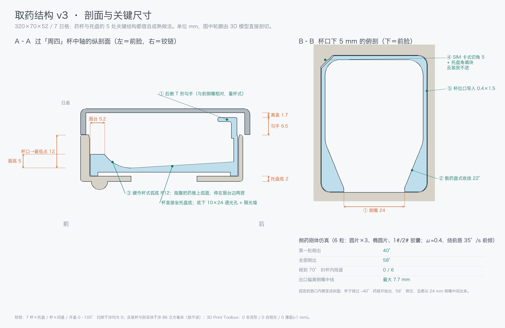

# IDEA-05B · 取药结构 v3（复用成熟工程做法）

> 日期：2026-10-26 · 状态：**已建模 + 已校验 + 已仿真**，待手板验证
> 模型：`model/v3/取药结构_v3.blend / .glb`（7 格托盘 + 7 杯 + 7 日盖）· 整机：`model/v3/IDEA-05_box_v3.blend`（见 `31_创新点详述_v3.md`）· STL：`stl/v3_药杯.stl`、`stl/v3_托盘.stl`
> 图：`design/30_取药结构v3_剖面与尺寸.png`、`renders/v3/`（`v3_*` 渲染、`sim_pour_*` 仿真帧）
> 脚本：`tools/v3/`（`params.py` 一处改参数 → `build_v3.py` 重建）



---

## 1. 为什么之前"效果不佳"：两个可量化的根因

| # | 现象 | 根因（实测） |
|---|---|---|
| 1 | 杯里的药不会自己往前聚 | 原杯底 3.4° / 前槽 4.8°，远小于药片在 PP 上的静摩擦角（μ≈0.3–0.45 → 17–24°）。斜底只在纸面上起作用。仿真里药片要倾到 **12–19°** 才开始动。 |
| 2 | "提杯倾斜 40–50° 倒出"做不到 | 原杯 5 mm 前唇的**内侧是直壁**：倾斜时药被压在前壁上，要沿前壁"爬"5 mm 才过唇。刚体仿真：**70° 时 6 粒全在杯里，85–100° 才倒出**，且有一粒从倒嘴外的杯沿翻出（偏离中线 15.2 mm）。 |
| 3 | 托盘两端外壁只有 0.55 mm | 原 310 宽托盘装 7 个 42.3 杯位（节距 44.43），两端只剩 0.55。由 3D Print Toolbox 薄壁检查查出。 |
| 4 | 之前几轮 3D 模型零件"飘"在空中 | 机构件各自建模、没有装配约束和干涉检查。本轮全部在同一坐标系里建、逐项校验。 |

另外两条修订：
- `design/25` 的 B1 方案"接缝线 z24 → 21.5"会切到前脸主键圈（z 0.7–23.3）和控制带（z 1.5–22.5）。**v3 保持接缝 z24**，杯落底换来的深度已经够用。
- `design/25/26` 的"托盘前壁 22×6×8 指扣槽"：前壁只有 3.8 厚，挖 6 深会挖穿密封面。v3 改为**后侧勾手**，不动前壁。

---

## 2. v3 用了哪 5 条成熟做法

| # | 借鉴对象 | 在药盒上的落法 | 参数 |
|---|---|---|---|
| ① | **量杯 / 水壶**：把手和倒嘴分在两端 | 杯后侧 T 形勾手（与后壁一体），前侧 24 mm 倒嘴。手指勾住勾手提杯，向前倾倒时手在药的反方向 | 勾手 20 宽、高出杯口 6.5、翼板前伸 5；离日盖内顶 2.5 |
| ② | **药房数药盘**的导流槽 | 杯前段侧壁向倒嘴收拢，药片排队出口，不从杯角翻出 | 收拢段 18 长，单侧 22°；倒嘴先 24 宽直通前壁再张开 |
| ③ | **收银机硬币杯**的弧形前底 | 聚药沟 → R12 弧面 → 5.2 宽唇台。不提杯时，指腹把药推上弧面，药停在唇台边缘，再捏起（不用在平底上抠） | 杯口→最低点 12，唇高 5，后端内底比最低点高 1.2 |
| ④ | **SIM 卡切角**防呆 | 杯后左角切角 5，托盘杯位对应角放填块。反装时杯角压在填块上放不下去 | 填块直角边 4.6；反装干涉 86 mm³（= 放不进） |
| ⑤ | **卡匣插座**导入倒角 | 托盘杯位口做导入倒角，杯子落下自己对中 | 四周 0.4，深 1.5（格板 2.23、托盘后壁 1.6 都薄，不能再大） |

其余跟着改的：托盘底 1 → 2，**杯直接坐在托盘底上**（原来悬空 1.5）；杯底取芯，壁厚均匀（注塑）；托盘底每格 10×24 通光孔 + 两侧 1.6 隔光墙（下沿离传感板 1.2）；托盘 310 → 312 宽、杯位 42.3 → 42.2，两端外壁 0.55 → 1.6。

整机集成时又改了两处（为了称重）：托盘底抬到 z24.8，与底座口留 0.8 浮动缝（外观上就是原分模线），托盘只压在称重浮动架上；托盘后缘收到 y63.4（杯位中心 y34.6），后面让给底座上的铰链脊——日盖挂在底座上，托盘可整盘取出。

---

## 3. 取药动作（两种都不需要捏力）

**A. 不提杯（日常，轻度手抖）**
开盖 → 食指从后往前一抹，药顺 R12 弧面上到唇台 → 在唇台边上捏起或直接拨进掌心。

**B. 提杯倒药（关节炎 / 手抖明显）**
开盖 → 食指勾住后侧 T 形勾手提杯（PP 杯约 11 g） → 向前倾斜 **40–60°** → 药从 24 mm 倒嘴集中流出 → 放回（导入倒角 + 防呆角，落下就对位）。

---

## 4. 校验结果（全部由脚本跑出，可复现）

**结构（`model/v3/v3_report.json`）**
- 7 杯 × 托盘、7 杯 × 闭合日盖、日盖 × 托盘干涉：**全 0**
- 日盖开合 0/15/30/45/60/75/90/105° 扫掠 × 杯 / 托盘：**全 0**
- 杯绕 Z 转 180° 反装：与防呆块干涉 **86 mm³**（放不进）
- 零件全部 watertight、单壳

**独立复检：3D Print Toolbox 扩展（`model/v3/print3d_check.json`）**
- 托盘 / 杯 / 日盖：**0 非流形边、0 自相交面、0 薄面（< 1.0 mm）**
- 这一步查出并已修掉：托盘两端 0.55 壁、勾手两次布尔造成的自相交、倒嘴两侧楔形薄边、日盖下沿刀口
- 剩余"零长边"是 < 0.1 mm 的布尔微边，"悬垂面"是 FDM 打印指标，对注塑件不构成问题

**倒药刚体仿真（`model/v3/sim_pour_report.json`，`tools/v3/sim_pour.py`）**
6 粒：Ø8 圆片×2、Ø10 圆片、14×7 椭圆片、1# / 2# 胶囊；μ=0.4；绕前唇约 35°/s 前倾到 100°。

| | 原设计杯 | v3 杯 |
|---|---|---|
| 第一粒倒出 | 85° | **40°** |
| 全部倒出 | 100° | **58°** |
| 70° 时杯内残留 | 6 / 6 | **0 / 6** |
| 出口偏离倒嘴中线 | 最大 15.2（从杯沿翻出） | **最大 7.7**（都在 24 mm 倒嘴内） |


> 仿真是刚体近似：没有静电、药粉、受潮粘连，摩擦取单一值。结论用于**方案比较**，绝对角度要以手板为准。

---

## 5. 没做 / 待验证

1. **手板**：打印 `stl/v3_药杯.stl` + `stl/v3_托盘.stl`，按 `design/12` 的受试者方案测：A 抹药成功率、B 倒药 40–60° 是否全出、勾手提杯力。
2. **弧底 R12 的手感**：硬币杯是平硬币，药片有厚度和圆角，可能需要 R10 / R15 两版对比（改 `params.COVE_R` 重建即可）。
3. **整机集成**：已完成，见 `model/v3/IDEA-05_box_v3.blend`、`design/32_整机v3_剖面A-A.png` 与 `31_创新点详述_v3.md`。
4. 日盖仍是外形替身（下开口腔体），**push-push 弹开机构、干燥片卡槽、多腔密封垫**本轮没建（不属于取药结构）。
5. 托盘 312 宽：外观上托盘两端离壳体外沿由 5 变 4 mm，需设计确认。

---

## 6. 怎么重建

```bash
B=/Applications/Blender.app/Contents/MacOS/Blender
$B -b --factory-startup --python tools/v3/build_v3.py          # 建模 + 结构校验 + 渲染 + 导出
$B -b model/v3/取药结构_v3.blend --python tools/v3/check_print3d.py   # 3D Print Toolbox 复检（需扩展，不加 --factory-startup）
$B -b --factory-startup --python tools/v3/sim_pour.py          # 倒药刚体仿真（原设计杯 vs v3）
$B -b --factory-startup model/v3/取药结构_v3.blend --python tools/v3/dump_sections.py
python3 tools/v3/draw_sheet.py                                 # 剖面与尺寸图板
```

本机已装 Blender 扩展（extensions.blender.org）：3D Print Toolbox、Bool Tool、CAD Sketcher（含 py-slvs 求解器）、MeasureIt、Section Toolbox。其中 Section Toolbox v0.0.2 实测导出不完整（只有零星投影线、按米制输出），剖面图改由 `dump_sections.py` 直接剖切网格生成。
